# esp32-cyd-board

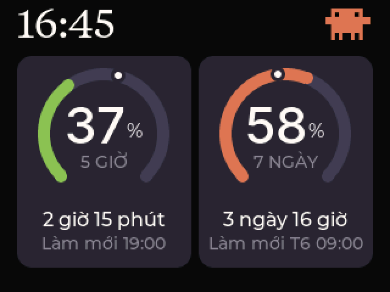

Shows **Claude quota usage** (5h / 7d windows), **clock**, and **temperature** on an **ESP32 CYD** board (ESP32-2432S028R, 240×320 ILI9341). PlatformIO + Arduino + LVGL 9.

The board connects to WiFi, calls `api.anthropic.com` directly with an OAuth token, reads the rate-limit headers, and draws two ring gauges. Clock comes from NTP, temperature from Open-Meteo (no API key needed).

Screen: header with the `HH:MM` clock (top-left) and Clawd (top-right), then two cards side by side, **5 giờ** and **7 ngày**. Each card has a ring gauge with the % used (green < 50% → amber < 80% → red) and a **white dot on the ring = how much of the window has already passed**: if the colored arc runs past the dot you are using the quota faster than it refills. Under the ring: time left until the reset ("2 giờ 15 phút") and the local reset time ("Làm mới 14:30", or weekday + time when it is not today: "Làm mới T5 09:00"). The countdown and the dot move every minute between polls. Status line at the bottom (token / API errors).

The whole on-screen UI is in Vietnamese. Pages (each page has its own icon at the top-right):

1. **Claude quota** (above)
2. **PC**: while the PC is on, CPU load gauge + CPU temperature and GPU / VRAM / RAM cards; while it is off, a **Wake-on-LAN** power button
3. **Thời tiết**: full-screen clock + weather: date, AQI, big clock with seconds, current conditions, lunar date, feels-like / humidity / wind, 4-day forecast (Open-Meteo)
4. **Lịch Âm** (lunar calendar): lunar date, Can Chi, countdown to the next Rằm / Mùng 1, next holiday
5. **Đếm ngược Tết**: only shows up from 30 days before Tết until Mùng 3 (days left, "Chúc Mừng Năm Mới" during Tết)
6. **Sự kiện** (your countdowns): birthdays, anniversaries, death anniversaries by the lunar calendar, trips; only shows when you have added some
7. **Giá cả** (prices), two tabs with their own header (title + segmented control, no shared clock): **Vàng · Tỷ giá** (SJC bar + SJC ring in million VND/lượng, USD/VND Vietcombank, Bitcoin in USD; one line each: buy, sell, ↑/↓ = change at the last adjustment, 24h % for Bitcoin) and **Xăng** (fuel table, below). The tabs are steps of the normal paging: tap right on Vàng · Tỷ giá → Xăng → next page, left goes back.
8. *(Xăng dầu is now the Xăng tab of Giá cả; the old separate page id is kept only so saved settings stay valid.)*

**Tap the right half of the screen (or press BOOT) for the next page, the left half for the previous one. On the PC page, while the PC is off, hold for 1 s to wake it** (holding does nothing anywhere else, so you can't wake it by accident). The board remembers the last page across reboots. Which pages are shown, and in which order, is set on the settings page.

## Screenshots

Rendered from the firmware's own LVGL page code at 320×240 (shown 2×), with sample data.

| Claude quota | PC (on) | PC (off, Wake-on-LAN) |
|:---:|:---:|:---:|
|  | 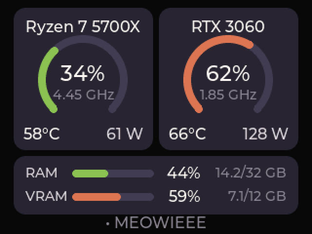 | 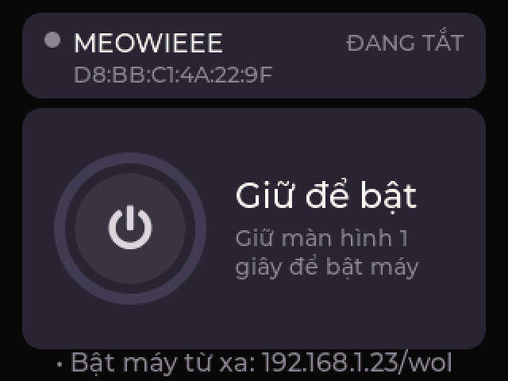 |
| **Thời tiết** | **Lịch Âm** | **Đếm ngược Tết** |
| 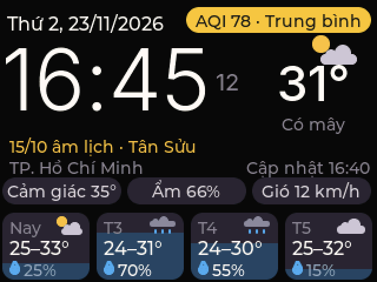 | 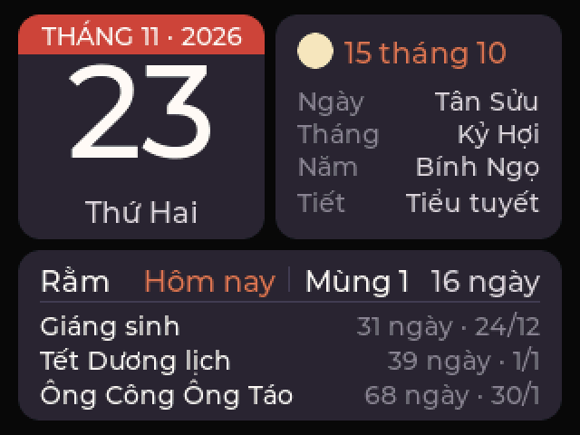 | 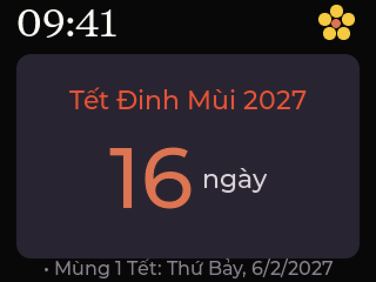 |
| **Giá cả · Vàng · Tỷ giá** | **Giá cả · Xăng** | **Sự kiện** |
| 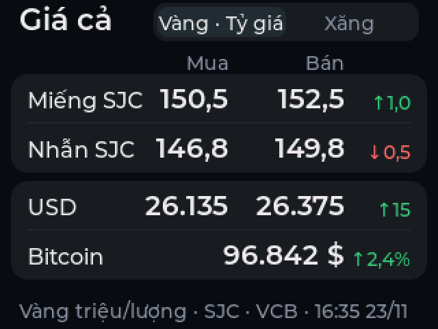 | 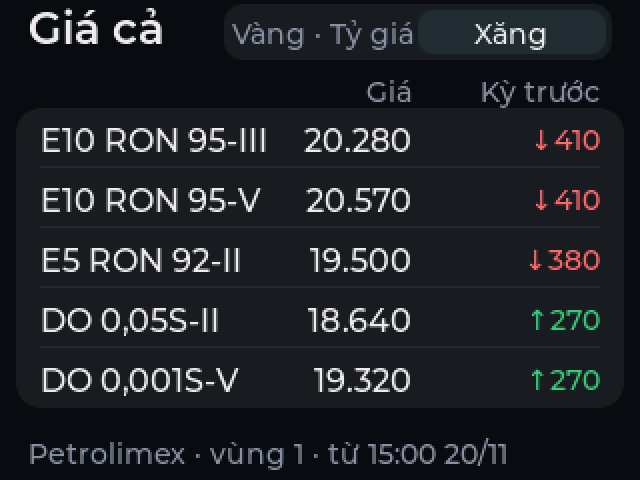 | 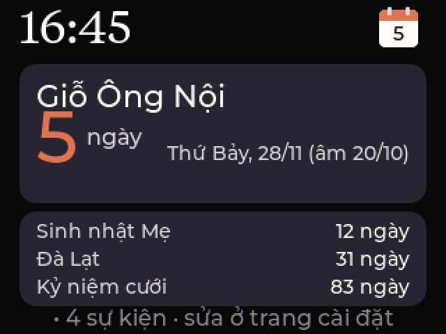 |

## Settings page (browser)

Open **`http://clawd.local`** (it redirects to `/settings`) or **`http://<board IP>/settings`**. Two tabs: **Cài đặt** and **WiFi**. Changes apply right away, no reflashing:

- **Claude token**: paste the token from `claude setup-token` (empty = keep the current one). The card shows whether the token works (*Hoạt động*, *Hết hạn / bị thu hồi*, *Lỗi API*) and the start / end of the token in use; the full token is never shown again. After a save the board switches to the quota page and tries the new token right away, no restart
- Weather location: pick a Vietnamese city or type coordinates
- Brightness, and after how long without PC data the screen turns off (or never)
- **Tự chuyển trang** (auto page flip): off, or every 5 s ... 2 min. A touch pauses it for 1 min; it never flips while the screen is dark, during touch calibration or while you hold the WoL button. Auto flips are not saved as "last page" (no flash wear)
- Pages: a switch to show / hide each one, arrows to set the order
- How many days before Tết the countdown page appears (0 = never)
- **Sự kiện của bạn**: up to 8 countdowns (see below)
- **Hiệu chỉnh cảm ứng** (touch calibration): the board asks you to tap the right edge, then the left edge

| Settings (`/settings`) | WiFi setup (`ESP32-CYD-Setup`) |
|:---:|:---:|
| 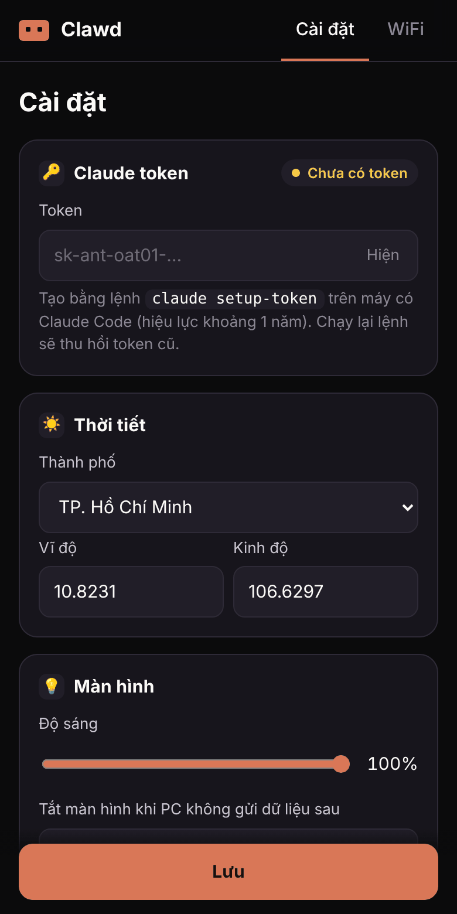 | 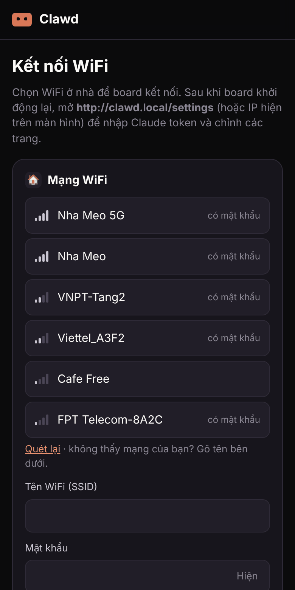 |

The **WiFi** tab (`/wifi`) shows the current network and lists nearby ones (strongest first, tap one to pick it) to switch networks; saving restarts the board.

The pages are dark, mobile-first, and share one stylesheet (`/ui.css`, cached). Every form carries a per-boot nonce, so another website open in the same browser can't submit them (after a board restart, reload the page before saving).

## Touch: left / right

The touch panel is only used as "where was the tap: left or right half?", so a 2-tap calibration is enough (no 4-corner calibration). It runs by itself on the first boot of this version (BOOT button = skip), and again whenever you press *Hiệu chỉnh cảm ứng* on the settings page. It figures out which of the XPT2046's two channels runs along the screen width and in which direction, so it works with either panel/rotation variant. Saved in NVS.

## Sự kiện (personal countdowns)

Added on the settings page, up to 8, each one:

| Type | Example | Next date |
|---|---|---|
| Dương lịch, hằng năm | birthday 5/12 | 5/12 this year or next (29/2 -> 28/2 in non-leap years) |
| Âm lịch, hằng năm | giỗ 20/10 âm | converted every year (20/10 âm 2026 = 28/11/2026); day 30 in a 29-day month -> day 29 |
| Một lần (dương lịch) | trip 24/12/2026 | disappears once it has passed |

Optional year for yearly events (birth year, wedding year) -> "lần thứ N". The page shows the nearest event big (days left, weekday + date, lunar date for lunar events) and the next 3 below; on the day itself: *Hôm nay!*. The page is hidden while there are no upcoming events. Icon: a calendar sheet with the days left.

## Xăng dầu (fuel prices)

Petrolimex retail prices, **zone 1** (vùng 1), VND/litre, as a table with columns *Giá* and *Kỳ trước*: **E10 RON 95-III**, **E10 RON 95-V**, **E5 RON 92-II**, **DO 0,05S-II**, **DO 0,001S-V**. Bottom line: *Petrolimex · vùng 1 · từ 15:00 05/11*.

- Source: Petrolimex's own CMS API (the one its website uses), fallback [VietFuel API](https://github.com/TranQui004/vietfuel-api). Refreshed every 20 min.
- The last prices are kept in NVS, so after each new price period the *Kỳ trước* column shows the change per product: **↓2.080** in red (down) / **↑500** in green (up), like Vietnamese price boards; `0` = unchanged, `--` = no previous period yet (first run).
- Fuel prices are fetched only while the Giá cả page is on screen (see *Network* below). **When a new period is detected, the Xăng tab is shown**, and the bottom line says *Vừa điều chỉnh giá · từ 15:00 19/11* for 24 h. A fallback source still on the previous period is ignored (no false alarm).

## Đếm ngược Tết (Tết countdown)

From N days before Tết (30 by default, settings page) until Mùng 3, an extra page appears after Lịch Âm: "Tết Đinh Mùi 2027" and the number of days left in big digits. Mùng 1-3: "Chúc Mừng Năm Mới! Xuân ... / Mùng N Tết". The date comes from the same lunar calendar code (Vietnamese Tết, UTC+7, which can differ by a day from Chinese New Year, e.g. 2/2/2030).


## PC status page

The board can't read your PC by itself, so a small script on the PC sends the numbers to the board every second (`POST http://clawd.local/pc`).

```bash
cd tools
pip install -r requirements.txt
python pc_monitor.py                      # board at clawd.local
python pc_monitor.py --host 192.168.1.23  # or the IP shown on the PC page
python pc_monitor.py --once               # just print what would be sent
```

On Windows, double-click `tools/run_pc_monitor.bat` to run it hidden (pythonw). To start it with Windows: `Win+R` → `shell:startup` → put a shortcut to the `.bat` there.

| Value | Source |
|---|---|
| CPU %, RAM | `psutil` (any OS) |
| CPU temperature | Windows: [LibreHardwareMonitor](https://github.com/LibreHardwareMonitor/LibreHardwareMonitor) running **as admin** with *Options → Remote Web Server → Run* (port 8085). Linux: `psutil` sensors |
| GPU %, temperature, VRAM used / total | LibreHardwareMonitor (NVIDIA / AMD / Intel), or `nvidia-smi` if present |

Anything the script can't read shows `--`. If no data arrives for 6 s the page blanks and shows `run pc_monitor.py -> <board IP>`.

Test without the script: `curl "http://clawd.local/pc?cpu=42&cpu_temp=61&ram_used=12.4&ram_total=32"`

## Screen sleep

When the PC sends nothing for **5 minutes** (PC off / asleep / script closed), the backlight fades out. Touch the screen or press BOOT to turn it back on: that touch only wakes the screen (no page switch, no Wake-on-LAN), and the screen stays on for 1 minute after the last touch. It also turns on by itself as soon as the PC sends data again. The delay (or "never") is on the settings page.

## Weather page

Full screen (the shared top clock is hidden here):

- Top: weekday + date, and an **AQI** pill (US AQI from Open-Meteo's air-quality API; Tốt / Trung bình / Kém / Xấu / Rất xấu / Nguy hại, colored by level)
- Big clock with seconds (Inter Light, `font_clock_72.c`), current temperature, icon and conditions
- Lunar date + Can Chi of the day, city, and on the right when it last updated (or the error)
- Pills: feels-like temperature, humidity, wind
- 4 day cards (today + 3): low–high, chance of rain; the blue fill rising from the bottom of each card is the chance of rain, under 10% shows *Khô ráo*

Uses the location chosen on the settings page (TP. Hồ Chí Minh by default). Refreshes every 15 min (retries every 2 min after an error).

## Lunar calendar page

Computed on the board, no internet needed (Hồ Ngọc Đức's algorithm, UTC+7; checked against the Tết dates 2020-2030, leap months and published Can Chi). Shows the lunar day / month (incl. leap months) / year, weekday and solar date, Can Chi of the day and month, how many days until the next **Rằm** and **Mùng 1**, and the next holiday on the bottom line (*Hôm nay: ...* on the day itself). The top-left icon is the moon phase of the lunar day.

Holidays: Tết Nguyên Đán, Giao thừa, Rằm tháng Giêng, Giỗ Tổ Hùng Vương, Phật Đản, Đoan Ngọ, Vu Lan, Trung Thu, Ông Công Ông Táo + solar ones (1/1, 14/2, 8/3, 30/4, 1/5, 1/6, 2/9, 20/10, 20/11, 24/12). Edit the lists at the bottom of `src/lunar/lunar.cpp`.

Vietnamese text needs its own fonts (`src/fonts/font_vn_*.c`, Montserrat Medium with Vietnamese letters, made with `lv_font_conv`): LVGL's built-in Montserrat has no Vietnamese.

## Prices page

| Row | Source | Refresh |
|---|---|---|
| Vàng SJC (1 lượng bar), million VND/lượng | sjc.com.vn price service (only answers Vietnamese IPs), fallback vnappmob.com | 10 min |
| USD buy (transfer) / sell | Vietcombank `api/exchangerates` (JSON). Fetched by `tools/pc_monitor.py` on the PC and sent with the PC stats; the board fetches it itself only while the PC isn't sending it (Vietcombank's bot filter often stalls the ESP32: HTTP -11) | 30 min |
| Bitcoin + 24 h change (and ≈ VND at VCB's sell rate) | Binance, fallback CoinGecko | 1 min while the page is shown, else 10 min |

The bottom line shows the last update time, or which source failed (e.g. `SJC lỗi (403)`).

## Wake-on-LAN (PC page, PC off)

The board learns the PC's MAC address by itself: `pc_monitor.py` sends the MAC of the network card it uses, and the board saves it (so it still works after the board reboots while the PC is off). Run the script once with the PC on, then:

- **Hold the screen for 1 s** on the PC page (while the PC is off) -> the ring fills, the board sends the magic packet, the page shows *Waking up...* and switches to *PC is on* as soon as `pc_monitor.py` starts sending again.
- Or from a phone on the same WiFi: open `http://<board IP>/wol` (or `/wol?mac=AA:BB:CC:DD:EE:FF` to set the MAC by hand).

The PC must allow WoL (one-time setup):

1. **BIOS/UEFI**: enable *Wake on LAN* / *Power On By PCI-E* / *Resume by PCI-E device*; disable *ErP / EuP Ready* / *Deep Sleep*.
2. **Windows** -> Device Manager -> your Ethernet adapter -> Properties:
   - *Power Management*: tick *Allow this device to wake the computer* and *Only allow a magic packet to wake the computer*.
   - *Advanced*: *Wake on Magic Packet* = Enabled.
3. **Turn off Fast Startup**: Control Panel -> Power Options -> *Choose what the power buttons do* -> untick *Turn on fast startup* (otherwise WoL often fails from "Shut down").
4. Use **Ethernet**. WoL over Wi-Fi almost never works; the page warns you if the PC is on Wi-Fi.

## Usage flow

1. Flash the firmware, power on. On first boot the board broadcasts an open WiFi network **`ESP32-CYD-Setup`**.
2. Connect your phone/laptop to it → the WiFi page opens automatically (or go to `http://192.168.4.1`).
3. Pick your **home WiFi** (2.4 GHz) and enter its password. Save → the board restarts and connects.
4. Open **`http://clawd.local/settings`** (or `http://<IP>/settings`, the quota page shows the address while no token is set) and paste your **Claude token** in the *Claude token* card. Save.
5. The quota page shows 5h / 7d usage %, refreshed every 60 seconds. To replace the token later, paste the new one in the same place.

Generate a token with `claude setup-token` on a machine with Claude Code installed (token looks like `sk-ant-oat01-...`, valid ~1 year). Running that command again **revokes the previous token**.

Hold the **BOOT button (GPIO0)** while powering on to wipe the WiFi config and return to step 1 (the token and the other settings are kept).

## Components

| Component | Role |
|---|---|
| `platformio.ini` | Board `esp32dev`, TFT_eSPI pin flags + LVGL |
| `partitions.csv` | Single app (~3.9 MB) + NVS. No OTA, no filesystem |
| `include/lv_conf.h` | LVGL 9.4 config (`LV_USE_TFT_ESPI`, 16-bit color, Montserrat 28 enabled) |
| `src/display/` | LVGL + TFT_eSPI init + backlight (PWM on GPIO 21) |
| `src/wifi_manager/` | WiFi connect + captive portal + WiFi page (`/wifi`, `/save`; `/` redirects to `/settings` on the LAN), NTP, mDNS `clawd.local` |
| `src/web/` | Shared web UI: stylesheet (`/ui.css`), chunked HTML writer (keeps the heap free), per-boot form nonce, HTML escaping |
| `src/claude_quota/` | Calls `POST api.anthropic.com/v1/messages`, reads `anthropic-ratelimit-unified-*` headers |
| `src/weather/` | Open-Meteo (no API key): current conditions + 5-day forecast + US AQI, every 15 min. `weather_parse.cpp` has no Arduino dependency (testable on a PC) |
| `src/wol/` | Wake-on-LAN: magic packet over UDP broadcast, MAC saved in NVS, `/wol` HTTP route |
| `src/ui/weather_page.*` | Weather page; icons are drawn from LVGL shapes (sun, moon, cloud, rain, snow, fog, storm) |
| `src/ui/wol_page.*` | Wake-on-LAN panel shown inside the PC page while the PC is off |
| `src/lunar/` | Lunar calendar: solar <-> lunar, Can Chi, upcoming Rằm / Mùng 1 / holidays (no Arduino dependency) |
| `src/ui/lunar_page.*` | Lunar calendar page (moon-phase icon) |
| `src/market/` | Gold / USD / BTC fetching (`market.cpp`) and JSON parsing (`market_parse.cpp`, testable on a PC) |
| `src/ui/market_page.*` | Giá cả page (tabs Vàng · Tỷ giá / Xăng) |
| `src/fonts/font_vn_*.c`, `font_num_52.c`, `font_num_72.c` | Vietnamese fonts (14/16/22 px) and big digits (lunar day, Tết countdown) |
| `src/settings/` | Settings page (`/settings`, `/touchcal`): Claude token, weather, screen, pages, events; stored in NVS |
| `src/ui/tet_page.*` | Tết countdown page (apricot-blossom icon) |
| `src/ui/touchcal.*` | Touch calibration overlay |
| `src/events/` | Personal countdowns: storage (NVS) + next occurrence (solar / lunar / one-time) |
| `src/ui/events_page.*` | Events page |
| `src/fuel/` | Petrolimex fuel prices: fetch (`fuel.cpp`), JSON parsing (`fuel_parse.cpp`, testable on a PC), adjustment detection |
| `src/ui/fuel_page.*` | Unused (merged into `market_page`), safe to delete |
| `src/pc_stats/` | Receives PC stats on `/pc` (form fields: `cpu`, `cpu_temp`, `gpu`, `gpu_temp`, `ram_used`, `ram_total`, `vram_used`, `vram_total`, `host`, plus `mac` / `nic` for Wake-on-LAN) |
| `src/ui/pc_page.*` | LVGL UI of the PC page (CPU arc gauge + GPU/VRAM/RAM cards) |
| `src/power/` | Screen sleep: backlight fade out / in based on PC data and touches |
| `src/touch/` | Tap (left / right half) / 1 s hold on the XPT2046, or the BOOT button; 2-tap calibration |
| `tools/pc_monitor.py` | PC-side sender (psutil + LibreHardwareMonitor / nvidia-smi) |
| `src/ui/quota_page.cpp` | Quota page body: the two ring gauges, reset countdown, time marker |
| `src/main.cpp` | Wires everything together, page navigation, shared header (Clawd, clock, temperature). The HTTPS fetches (quota, weather, prices, fuel) run in a FreeRTOS task on core 0 so touch and drawing on core 1 never freeze; the task only hands data over (copy + flag), all LVGL calls stay on core 1. **Only the page on screen fetches its data** (quota page: Claude quota; weather page: weather; Giá cả: gold, USD, BTC, fuel; PC / lunar / Tết / events: nothing), nothing while the screen is dark, and no request starts while the heap is low: the ESP32 (no PSRAM) has ~100-150 KB free and each HTTPS request needs ~45 KB, shared with LVGL |

## How the quota API works

```
POST https://api.anthropic.com/v1/messages
  Authorization: Bearer <oat01 token>
  anthropic-version: 2023-06-01
  anthropic-beta: oauth-2025-04-20      # required to use an OAuth token
  Content-Type: application/json
  User-Agent: claude-code/2.1.5
  body: {"model":"claude-haiku-4-5-20251001","max_tokens":1,"messages":[{"role":"user","content":"hi"}]}
```

The numbers live **in the response headers**, not the body:

| Header | Meaning |
|---|---|
| `anthropic-ratelimit-unified-5h-utilization` | 0.0–1.0 → ×100 = % used in the 5h window |
| `anthropic-ratelimit-unified-5h-reset` | epoch seconds → time until reset |
| `anthropic-ratelimit-unified-7d-utilization` / `-7d-reset` | 7-day window |
| `anthropic-ratelimit-unified-overage-*` | Enterprise/overage accounts |

`401` = token expired or revoked. Idea borrowed from [Clawdmeter](https://github.com/HermannBjorgvin/Clawdmeter) (the original runs as a PC daemon and sends data over BLE; here the board calls the API itself).

## Hardware (hardcoded in `src/display/display.h`)

Board: ESP32 CYD (ESP32-2432S028R)

- 240×320, rotated `LV_DISPLAY_ROTATION_270` (landscape)
- Display SPI: MISO=12, MOSI=13, SCLK=14, CS=15, DC=2, RST=-1
- Driver `ILI9341_2_DRIVER`, SPI 55 MHz, backlight on GPIO 21
- Touch XPT2046 on its own SPI bus (HSPI): CLK=25, MOSI=32, MISO=39, CS=33, IRQ=36 — used for tap left / right half and hold (2-tap calibration, see above)

## Build

```bash
pio run                # build
pio run -t upload      # flash
pio device monitor     # serial 115200
```
